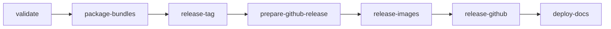

# Build from Source

How to build the Open AD Kit images locally, how CI builds them, and how
releases are cut. Most users do not need this; pull the published images
instead (see [Container Images & Versioning](../getting-started/container-images.md)).

## Prerequisites

- Ubuntu 22.04 or 24.04 (`openadkit setup` supports Ubuntu only; elsewhere,
  install Docker with Buildx and Compose yourself)
- Git, `pipx`, `vcs2l`, and `python3-yaml` to import the Autoware sources
- Disk space for several multi-gigabyte images

The component Dockerfiles build on upstream Autoware images from GHCR and
compile their package sets from a local `autoware/src` tree (step 4 below).

## Build System

Images are built with [Docker Bake](https://docs.docker.com/build/bake/) from
[`components/docker-bake.hcl`](https://github.com/autowarefoundation/openadkit/blob/main/components/docker-bake.hcl),
the same file CI uses.

--8<-- "includes/build-pipeline.md"

`universe-common` compiles the shared part of Autoware Universe on the upstream
`core-devel` image and copies the result onto the lean upstream `base` image, so
build tools never reach the runtime layers. Every component builds from it.
`sensing-perception-cuda` builds on the upstream CUDA images and adds the
`universe-common` install tree.

The published images end with a per-build Ubuntu security refresh. Components
compile on `universe-common-build`, the devel image without that refresh, which
CI pushes only to its build cache. Its digest changes only with its inputs, so a
build that changes no Autoware source or component Dockerfile reuses the cached
compiles and only refreshes and reassembles the runtime images.

| Group | Targets | Published to |
|-------|---------|--------------|
| `universe-common` | `universe-common-devel`, `universe-common` | `ghcr.io/autowarefoundation/openadkit-common` |
| `component` | all component images, including the amd64-only `sensing-perception-cuda` and `carla-interface` | `ghcr.io/autowarefoundation/openadkit` |
| `planning` | `universe-common` plus the images Planning Simulation needs | — (local builds) |
| `default` | `universe-common` + `component` | — |

## Build and Run Locally

```bash
# 1. Clone the repository
git clone https://github.com/autowarefoundation/openadkit.git
cd openadkit

# 2. Install host dependencies
./openadkit setup --verify
```

--8<-- "includes/docker-group-activation.md"

```bash
# 3. Make the pipx-installed vcs command available in this shell
export PATH="$HOME/.local/bin:$PATH"

# 4. Import the Autoware sources this branch pins
AUTOWARE_REF=$(cat .github/autoware.ref)
git init autoware
git -C autoware fetch --depth 1 \
  https://github.com/autowarefoundation/autoware.git "$AUTOWARE_REF"
git -C autoware checkout --detach FETCH_HEAD
if [ -f .github/autoware-lock.repos ]; then
  # main: a snapshot of upstream development, every dependency pinned, and
  # core built locally
  cp .github/autoware-lock.repos autoware.lock
  export UPSTREAM_TAG=""
else
  # release/X.Y: an Autoware release, built on its official images
  python3 .github/scripts/export_autoware_lock.py \
    autoware/repositories/autoware.repos autoware.lock
  export UPSTREAM_TAG="$AUTOWARE_REF"
fi
mkdir -p autoware/src
vcs import --shallow autoware/src < autoware.lock
mkdir -p autoware/src/middleware/external
touch autoware/src/middleware/external/.keep

# 5. Build the shared universe-common layer (~2 hours, more with core)
docker buildx bake -f components/docker-bake.hcl universe-common

# 6. Build the Planning Simulation images (~2 hours)
docker buildx bake -f components/docker-bake.hcl --load planning

# 7. Run with the local images
./openadkit run planning-simulation
```

- `--load` puts the images in the local Docker store; without it, Bake only
  fills the build cache.
- Local builds are tagged `<target>-<arch>-<ros-distro>` (for example
  `planning-control-amd64-humble`), which is the tag `./openadkit` looks up in a
  source checkout. The arch follows the build host; when cross-building, set tags
  with `--set <target>.tags=...`. To use other images, set the `*_IMAGE`
  variables in `~/.config/openadkit/<deployment>.env`.
- For Jazzy, build with `ROS_DISTRO=jazzy` and run with `--ros-distro jazzy`.
- `main` builds for upstream development; check out a `release/X.Y` branch to
  build a release's sources.

Other useful targets:

```bash
docker buildx bake -f components/docker-bake.hcl                                # everything
docker buildx bake -f components/docker-bake.hcl component                      # all components
docker buildx bake -f components/docker-bake.hcl --load sensing-perception      # one image
```

### Build Variables

| Variable | Description | Default |
|----------|-------------|---------|
| `ROS_DISTRO` | `humble` or `jazzy` | `humble` |
| `UPSTREAM_TAG` | Upstream Autoware release to build on (e.g. `1.9.0`). Empty builds for upstream development: core compiles from `autoware/src` on the moving `base-<distro>` image, and ROS installs from the live repository. | `""` |
| `UPSTREAM_REPO` | Upstream Autoware image repository | `ghcr.io/autowarefoundation/autoware` |
| `ROS_SNAPSHOT_HUMBLE`, `ROS_SNAPSHOT_JAZZY` | ROS apt snapshot the `UPSTREAM_TAG` images were built from. The build fails when they do not match; see [ROS snapshot](https://github.com/autowarefoundation/openadkit/blob/main/components/shared/ros-snapshot/README.md). | Snapshots for `1.9.0` |

## Continuous Integration

[`build-all-images.yaml`](https://github.com/autowarefoundation/openadkit/blob/main/.github/workflows/build-all-images.yaml)
builds every target with the same Bake file. The build matrix comes from
[`.github/image-inventory.json`](https://github.com/autowarefoundation/openadkit/blob/main/.github/image-inventory.json),
the source of truth for which images are built and for which architectures.

Jobs run in dependency order: `prepare`, then `build-common`, then
`build-components`, then `build-carla-interface`. Most images build for Humble and
Jazzy on amd64 and arm64. `create-manifests` then combines the per-arch images
into multi-arch tags. CI disables the local tags (`LOCAL_IMAGE=""`) and tags
images through `docker/metadata-action`. A failed scheduled build opens a GitHub
issue.

Each branch's [`.github/autoware.ref`](https://github.com/autowarefoundation/openadkit/blob/main/.github/autoware.ref)
pins its Autoware sources. A `release/X.Y` branch pins an Autoware release and
builds on its official images. `main` pins a commit of upstream `main` together
with its dependency lock,
[`.github/autoware-lock.repos`](https://github.com/autowarefoundation/openadkit/blob/main/.github/autoware-lock.repos),
and compiles core in the same Bake graph. Once a week
[`bump-autoware.yaml`](https://github.com/autowarefoundation/openadkit/blob/main/.github/workflows/bump-autoware.yaml)
moves that snapshot to the current upstream `main` in a pull request from
`ci/bump-autoware`, which builds every image and runs the evidence cells, so an
upstream change that breaks Open AD Kit fails that pull request instead of
`main`. CI builds `main` and `release/*` pushes; registry caches are kept per
branch, and the bump shares `main`'s.

## Release Process

Releases promote an existing CI build; nothing is rebuilt.

### Before You Release

- **A `release/X.Y` branch** exists for the version, created from `main`. Its
  `.github/autoware.ref` names the Autoware release (for example `1.9.0`), and
  the ROS snapshots in `components/docker-bake.hcl` belong to that release.
- **`vars.RUNNER_AMD64`** and **`vars.RUNNER_ARM64`** optionally move the build,
  scan and evidence jobs to larger runners (for example
  `ubicloud-standard-8-ubuntu-2204` and `ubicloud-standard-8-arm-ubuntu-2204`).
  Unset, they run on the GitHub-hosted `ubuntu-22.04` and `ubuntu-22.04-arm`.
- **GHCR packages** accept pushes from CI: `openadkit`, `openadkit-common`, and
  `openadkit-buildcache` under `ghcr.io/autowarefoundation/`.
- **`secrets.RELEASE_TOKEN`** (Contents and Workflows write) is set when promoting
  a build commit older than later workflow changes; otherwise `GITHUB_TOKEN` is
  used.
- **A successful build** of `build-all-images` exists on `release/X.Y`; stable
  and pre-releases `vX.Y.Z` both come from it, and `main` builds are never
  released. The build summary shows its `build_tag`. The release ships the CLI
  and deployments from that build's commit, and pushes that change only those
  start no build: dispatch `build-all-images` on the branch to release them. The
  release run warns when the branch has such changes.
- **A passing scan** of `scan-images` exists for that `build_tag`, dispatched on
  the same `release/X.Y` branch.
- **Complete signed `PASSED` evidence** exists for that same build, from
  `evidence` dispatched on the same branch. Required
  cells, source checksums and image digests must match; quarantine does not waive
  the gate. See [Evidence Policy](../releases/evidence.md).

### Workflow

Run [`release.yaml`](https://github.com/autowarefoundation/openadkit/blob/main/.github/workflows/release.yaml)
on the same `release/X.Y` branch with the version and `build_tag`. A release
line releases with its own workflows and scripts, so a later `main` cannot
change how an older line is validated. Its jobs run in order:



1. **validate**: runs the release gates in
   [`validate_release.sh`](https://github.com/autowarefoundation/openadkit/blob/main/.github/scripts/validate_release.sh)
   (version format, build provenance and age, scan results, metadata and file
   integrity, image coverage, signed L0-L2 evidence, registry digests, Git tag). Nothing is tagged if a
   gate fails.
2. **package-bundles**: writes the immutable release plan and the runtime bundle
   for both distros.
3. **release-tag**: creates or verifies the Git tag.
4. **prepare-github-release**: writes notes/metadata from the validated plan,
   attests bundle/installer/plan/metadata, then creates the draft with its assets.
5. **release-images**: creates the release tags and, for stable releases, the
   moving aliases (see [Tag Reference](../getting-started/container-images.md#tag-reference)).
6. **release-github**: publishes the draft.
7. **deploy-docs**: republishes the docs when the stable aliases moved.

The release plan (`release-plan.json`) attached to each GitHub Release records
the exact image digests, aliases, assets, and checksums of that release.
