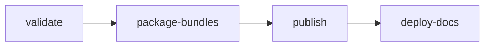

# Release Process

For maintainers. A release promotes an existing CI build of its branch; nothing
is rebuilt. The [Evidence Policy](../releases/evidence.md) says what a build
must pass and [What the Gate Checks](#what-the-gate-checks) how a release checks it, and [Compatibility](../releases/compatibility.md) what a version
number promises.

## Before You Release

- **The branch:** `main`, or a `release/X.Y` branch created from a release tag
  to fix an older line. Its `.github/autoware.ref` names the Autoware release
  (for example `2.0.0`), and the ROS snapshots in `components/docker-bake.hcl`
  belong to that release.
- **`vars.RUNNER_AMD64`** and **`vars.RUNNER_ARM64`** optionally move the build,
  scan and evidence jobs to larger runners (for example
  `ubicloud-standard-8-ubuntu-2204` and `ubicloud-standard-8-arm-ubuntu-2204`).
  Unset, they run on the GitHub-hosted `ubuntu-22.04` and `ubuntu-22.04-arm`.
  Pull request jobs run on them too, so point them only at ephemeral hosted
  runners, never at a persistent self-hosted machine.
- **GHCR packages** accept pushes from CI: `openadkit`, `openadkit-buildcache`
  and `openadkit-ci` under `ghcr.io/autowarefoundation/`.
- **`secrets.RELEASE_TOKEN`** (Contents and Workflows write) is set when promoting
  a build commit older than later workflow changes; otherwise `GITHUB_TOKEN` is
  used.
- **The `release` environment** exists in the repository settings: the publish
  job runs in it, so the reviewers required there approve each release.
- **Immutable releases** are on in the repository settings: a published
  release and its tag cannot change. The publish step fails when a release it
  published is not immutable.
- **A successful build** of `build-all-images` exists on that branch; stable
  releases and pre-releases both come from it. The build summary shows its
  `build_tag`. The release ships the CLI and deployments of that build's
  commit. A push that changes only the CLI or deployments starts no build, so
  dispatch `build-all-images` on the branch to release it; the release run
  warns when the branch has such changes.
- **A passing scan** of `scan-images` exists for that `build_tag` on the same
  branch; it runs after the build.
- **A successful `evidence` run** on the same branch passed every cell for that
  same build; it runs after the build. See the
  [Evidence Policy](../releases/evidence.md).
- **Highlights** for a minor or major release are in
  `.github/release-highlights/vX.Y.Z.md`. The notes of that release and of its
  candidates open with them; the rest of the notes is generated.
- **The docs on `main`** describe the release: a stable release publishes the
  site from `main` as it is then. For the first stable release, remove the
  "not published yet" notes first, from `README.md` and
  `docs/includes/first-release-note.md` with the two lines that include it.

## Workflow

Run [`release.yaml`](https://github.com/autowarefoundation/openadkit/blob/main/.github/workflows/release.yaml)
on the build's branch with the version and `build_tag`. A `release/X.Y` branch
releases with its own workflows and scripts, so a later `main` cannot change
how an older line is validated. Its jobs run in order:

1. **validate**: runs the release gates in
   [`validate_release.sh`](https://github.com/autowarefoundation/openadkit/blob/main/.github/scripts/validate_release.sh)
   (version format, the build run and its age, scan results,
   metadata and file integrity, image coverage, passing evidence, registry
   digests, Git tag). A build older than 90 days cannot be promoted. Nothing is
   tagged if a gate fails.
2. **package-bundles**: writes the immutable release plan and the runtime bundle
   for both distros.
3. **publish**: writes the notes and metadata from the validated plan, attests
   the bundle, installer and metadata, and creates the draft with its
   assets. It then creates the image release tags and, for stable releases, the
   latest aliases (see
   [Tag Reference](../releases/container-images.md#tag-reference)), and
   publishes the draft, which creates the Git tag. A published release cannot
   be changed: a bad one is followed by the next version.
4. **deploy-docs**: publishes the docs site from `main` when the latest
   aliases moved. If it fails after a publish, re-run only the failed job or
   dispatch `deploy-docs`: re-running all jobs stops at the draft step, since
   the release is already published.

The release plan records the exact image digests, aliases and assets of the
release for the jobs after it; it stays in the workflow run. The release itself
publishes `release-metadata.json`.

## What the Gate Checks

Before creating a tag, release validation looks for an
`evidence-summary-<build_tag>` artifact and accepts it only when:

1. **The run succeeded:** it is a completed, successful run of
   `.github/workflows/evidence.yaml` on the branch that built the release, in
   this repository and not for a pull request.
2. **It tested this build:** the summary names the promoted build tag, and it
   tested the build's own commit, not another commit against its images.
3. **Every cell passed:** the summary result is `PASSED`. A cell passes only
   when every level it runs passes, and a missing expected cell fails the run.

A passing rerun may supersede a failed run; a failed run never counts. There is
no release bypass input. The release also requires the latest full scan of the
build to pass.

## Autoware and ROS Distro Decisions

Every release, stable or candidate, is a build of `main` (or of a
`release/X.Y` branch that fixes an older line) on the Autoware release tag in
`.github/autoware.ref`. The release records that Autoware version; the build's
`autoware-lock.repos`, resolved SHA and upstream image digests record the
input.

- **Autoware:** pin the latest stable Autoware release at the release cut. If
  it has a blocking issue, keep the previous verified pin and explain the
  exception, date and follow-up in the release notes. A fix that is already
  upstream can be
  [backported](#backporting-an-autoware-fix)
  instead.
- **ROS distro:** `defaultRosDistro` in the promoted `openadkit.json` selects
  the default, and the evidence cells of every declared distro must pass. The
  gate never switches from Humble to Jazzy or drops a failing distro by itself:
  to change the supported distros, update the manifests in a reviewed change
  and build and test that revision.

## Release Metadata

The release workflow seals the selected evidence summary (result, build,
commit, run URL and cells) in its release plan before packaging.
`release-metadata.json` publishes that same evidence, the BOM and the CI
exemptions. The bundle, installer and metadata receive build provenance from
the release workflow.

The verification table in the release notes shows the passing-cell count,
readiness time, arrival time and peak memory of that build. A release never
searches older runs or releases; its notes depend only on its release plan.
Missing metrics are shown as `-`, never replaced with zeroes.

See [Verify a Release](../releases/verification.md) to check a release yourself.

## The Docs Site

The site documents the latest stable release. A push to `main` does not
publish it: a docs change reaches the site with the next stable release, and a
pull request shows its own preview. To publish a fix in between, dispatch
[`deploy-docs.yaml`](https://github.com/autowarefoundation/openadkit/blob/main/.github/workflows/deploy-docs.yaml),
which builds the site from `main`; do that only while `main` documents nothing
the latest release lacks.

A fork can rehearse a release with the same workflow: it promotes its own
build in its own registry namespace and publishes in the fork. Validation only
requires the registry and the package name that `openadkit.json` names.

## Backporting an Autoware Fix

Autoware releases come months apart. A fix that blocks a release and is
upstream, merged on Autoware's `main` or in an open pull request, can ride on
the pinned release as a patch instead of waiting for the next Autoware release:

1. In the upstream repository, `git format-patch -1 <commit>`, and add a line
   `Upstream: <URL of the commit or pull request>` to its message.
2. Open a pull request into `main` (or the `release/X.Y` branch) that adds it as
   `.github/autoware-patches/<repository>/<NNNN>-<subject>.patch`, where
   `<repository>` is its path under `autoware/src` (a key of
   `autoware-lock.repos`, such as `universe/autoware_universe`). The review is
   the fix's own diff.
3. Every build applies the patches in order right after `vcs import`; one that
   does not apply, or has no `Upstream:` line, fails the build. The release
   lists them under **Backported Autoware fixes**, its bundle carries them as
   `autoware.backports`, and `openadkit version` counts them. The Autoware
   version stays that of the tag.
4. When the branch moves to an Autoware release that contains the fix, delete
   the patch.
