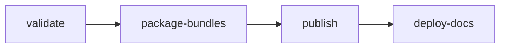

# Release Process

For maintainers. A release promotes an existing CI build of its branch; nothing
is rebuilt. The [Evidence Policy](../releases/evidence.md) says what a build
must pass, and [Compatibility](../releases/compatibility.md) what a version
number promises.

## Before You Release

- **The branch:** `main`, or a `release/X.Y` branch created from a release tag
  to fix an older line. Its `.github/autoware.ref` names the Autoware release
  (for example `2.0.0`), and the ROS snapshots in `components/docker-bake.hcl`
  belong to that release.
- **`vars.RUNNER_AMD64`** and **`vars.RUNNER_ARM64`** optionally move the build,
  scan and evidence jobs to larger runners (for example
  `ubicloud-standard-8-ubuntu-2204` and `ubicloud-standard-8-arm-ubuntu-2204`).
  Unset, they run on the GitHub-hosted `ubuntu-22.04` and `ubuntu-22.04-arm`.
  Pull request jobs run on them too, so point them only at ephemeral hosted
  runners, never at a persistent self-hosted machine.
- **GHCR packages** accept pushes from CI: `openadkit`, `openadkit-buildcache`
  and `openadkit-ci` under `ghcr.io/autowarefoundation/`.
- **`secrets.RELEASE_TOKEN`** (Contents and Workflows write) is set when promoting
  a build commit older than later workflow changes; otherwise `GITHUB_TOKEN` is
  used.
- **A successful build** of `build-all-images` exists on that branch; stable
  releases and pre-releases both come from it. The build summary shows its
  `build_tag`. The release ships the CLI and deployments of that build's
  commit. A push that changes only the CLI or deployments starts no build, so
  dispatch `build-all-images` on the branch to release it; the release run
  warns when the branch has such changes.
- **A passing scan** of `scan-images` exists for that `build_tag` on the same
  branch; it runs after the build.
- **A successful `evidence` run** on the same branch passed every cell for that
  same build; it runs after the build. See the
  [Evidence Policy](../releases/evidence.md).
- **Highlights** for a minor or major release are in
  `.github/release-highlights/vX.Y.Z.md`. The notes of that release and of its
  candidates open with them; the rest of the notes is generated.
- **The [roadmap](../roadmap.md) is reviewed** for a minor or major release:
  finished items are gone, the release's items are under Now, and its
  `Last reviewed` line names the release. Validation checks that line for the
  release and its candidates.

## Workflow

Run [`release.yaml`](https://github.com/autowarefoundation/openadkit/blob/main/.github/workflows/release.yaml)
on the build's branch with the version and `build_tag`. A `release/X.Y` branch
releases with its own workflows and scripts, so a later `main` cannot change
how an older line is validated. Its jobs run in order:

1. **validate**: runs the release gates in
   [`validate_release.sh`](https://github.com/autowarefoundation/openadkit/blob/main/.github/scripts/validate_release.sh)
   (version format, roadmap review, build provenance and age, scan results,
   metadata and file integrity, image coverage, passing evidence, registry
   digests, Git tag). A build older than 90 days cannot be promoted. Nothing is
   tagged if a gate fails.
2. **package-bundles**: writes the immutable release plan and the runtime bundle
   for both distros.
3. **publish**: writes the notes and metadata from the validated plan, attests
   the bundle, installer, plan and metadata, and creates the draft with its
   assets. It then creates the image release tags and, for stable releases, the
   latest aliases (see
   [Tag Reference](../getting-started/container-images.md#tag-reference)), and
   publishes the draft, which creates the Git tag. A published release cannot
   be changed: a bad one is followed by the next version.
4. **deploy-docs**: republishes the docs when the latest aliases moved.

The release plan (`release-plan.json`) attached to each GitHub Release records
the exact image digests, aliases, assets, and checksums of that release.

A fork can rehearse a release with the same workflow: it promotes its own
build in its own registry namespace and publishes in the fork. Validation only
requires the registry and the package name that `openadkit.json` names.

## Backporting an Autoware Fix

Autoware releases come months apart. A fix that blocks a release and is
upstream, merged on Autoware's `main` or in an open pull request, can ride on
the pinned release as a patch instead of waiting for the next Autoware release:

1. In the upstream repository, `git format-patch -1 <commit>`, and add a line
   `Upstream: <URL of the commit or pull request>` to its message.
2. Open a pull request into `main` (or the `release/X.Y` branch) that adds it as
   `.github/autoware-patches/<repository>/<NNNN>-<subject>.patch`, where
   `<repository>` is its path under `autoware/src` (a key of
   `autoware-lock.repos`, such as `universe/autoware_universe`). The review is
   the fix's own diff.
3. Every build applies the patches in order right after `vcs import`; one that
   does not apply, or has no `Upstream:` line, fails the build. The release
   lists them under **Backported Autoware fixes**, its bundle carries them as
   `autoware.backports`, and `openadkit version` counts them. The Autoware
   version stays that of the tag.
4. When the branch moves to an Autoware release that contains the fix, delete
   the patch.
